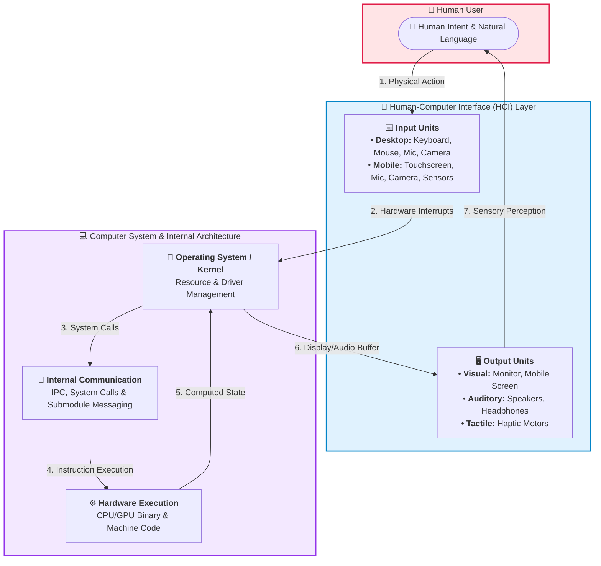
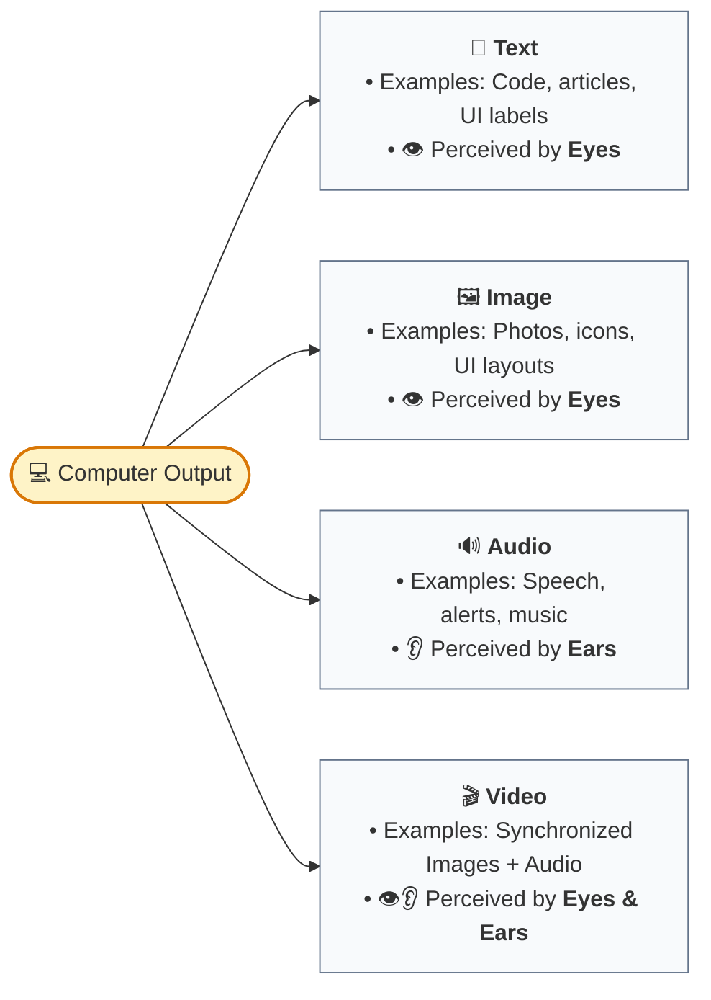
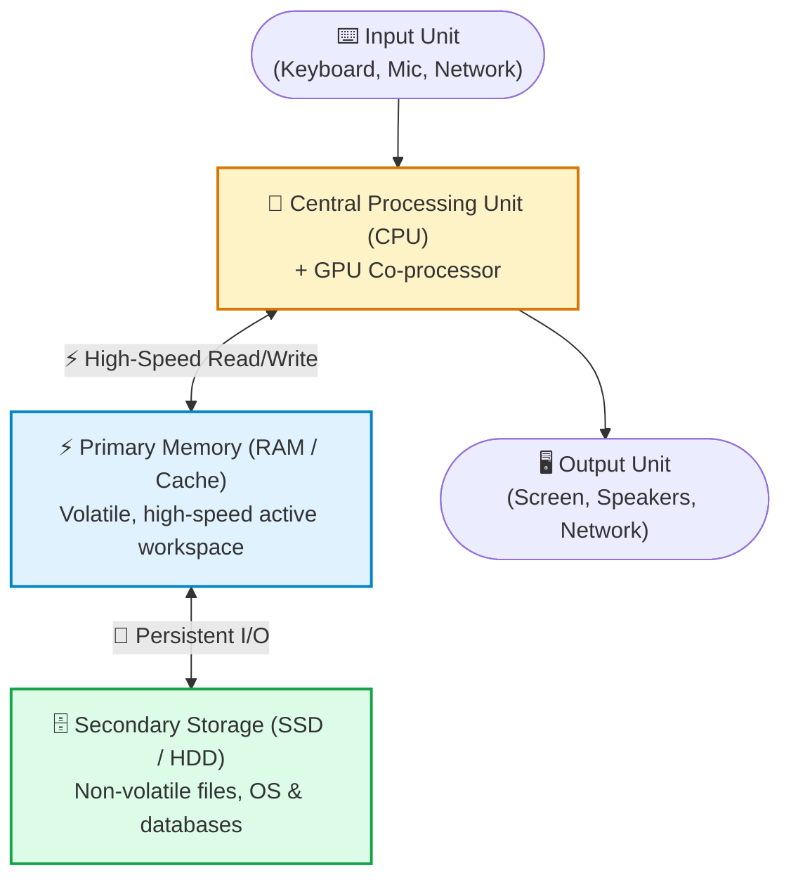
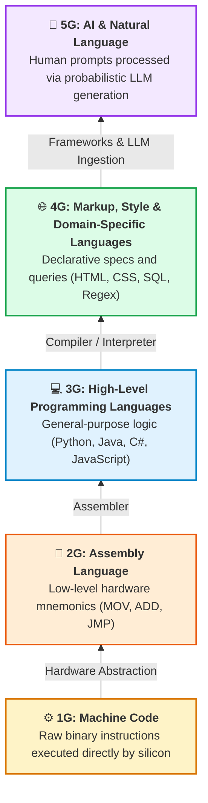
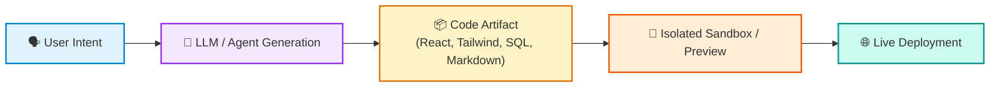
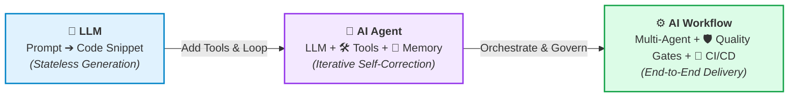

# 🚀 AI-Driven Web Application Development

A foundational guide tracing the evolution of computing—from physical hardware and human-computer interfaces to autonomous, AI-driven software engineering.

---

## 1. 🖥️ How Do Humans Operate a Computer?

> [!NOTE]
> **Answer:** Through a **Human-Computer Interface (HCI)**—the physical and digital bridge that translates human actions into binary signals and converts machine outputs back into sensory feedback.



---

## 2. 📡 How Do Humans Receive Information from a Computer?

Computers encode raw binary states into **four primary sensory formats** tailored to human perception:



---

## 3. 🧩 What Is the Architecture of a Physical Computer?

> [!NOTE]
> **Answer:** Modeled on the **Von Neumann Architecture** (augmented by modern parallel co-processors), a computer system relies on core hardware subsystems working together to process and store data.



| Subsystem | System Role | Real-World Analogy |
| --- | --- | --- |
| **🧠 CPU & GPU** | The CPU executes sequential logic; the GPU handles massively parallel matrix calculations | The head chef and kitchen brigade |
| **⚡ Primary Memory (RAM)** | Temporary, ultra-fast workspace for active applications and AI models | The kitchen countertop |
| **🗄️ Secondary Storage** | Long-term, persistent storage for codebases, assets, and databases | The pantry and refrigerator |
| **⌨️ Input / 🖥️ Output** | Hardware interfaces connecting the machine to users and networks | The order ticket and serving window |

---

## 4. 🪜 The 5 Levels of Computer Language & Abstraction

> [!NOTE]
> **Answer:** Computing has evolved from instructing silicon via raw binary machine code (**1G**) to probabilistic token generation and semantic reasoning via Large Language Models (**5G**).



---

## 5. 📄 Artifacts in AI Code & Web Generation

When language models and AI agents bridge natural human intent (**5G**) with programmatic web code (**4G**), they produce structured deliverables known as **Artifacts**.

An **artifact** is a self-contained, reviewable output—such as a React component, a stylesheet, a database schema, or an entire project workspace—that can be previewed, edited, and deployed independently of the main conversation thread.



* **Modular Isolation:** Separates conversational dialogue from clean, production-ready source code.
* **Live Interactive Preview:** Executes inside browser sandboxes (e.g., Vite/React runtimes) for immediate visual verification.
* **Iterative Patching:** Enables agents to update specific code blocks (`Plan -> Act -> Observe -> Fix`) without regenerating entire files.

---

## 6. 🔄 What Is "AI-Driven Web Application Development"?

It is a software-mediated execution pipeline: human intent enters as natural language (**5G**), passes through neural networks and deep learning stacks, and is synthesized into production web code (**4G markup and scripting**) running on cloud infrastructure.

```mermaid
flowchart LR
    H(["👤 Human<br/>Creator & End-User"])
    NL["🗣️ Natural Language<br/>Prompts & Feedback"]
    G5["🤖 5G: AI / LLM<br/>Token Generation"]
    SoftwareStack["💻 <b>Software Stack</b><br/>Frameworks, OS, Drivers & Runtime"]
    G4["📄 4G: Web Code<br/>HTML / CSS / JS / SQL"]
    WEB(["🌐 Hosted Website<br/>Live Cloud Deployment"])

    H -->|"1. Expresses Intent"| NL
    NL -->|"2. Feeds Prompt"| G5
    G5 -->|"3. Probabilistic Inference"| SoftwareStack
    SoftwareStack -->|"4. Synthesizes Code"| G4
    G4 -->|"5. Deploys & Serves"| WEB

    H <-->|"6. Uses, Tests & Iterates"| WEB

    style H fill:#ffe4e6,stroke:#e11d48,stroke-width:2px,color:#881337
    style NL fill:#e0f2fe,stroke:#0284c7,stroke-width:2px,color:#0c4a6e
    style G5 fill:#f3e8ff,stroke:#9333ea,stroke-width:2px,color:#3b0764
    style SoftwareStack fill:#fef3c7,stroke:#d97706,stroke-width:2px,color:#78350f
    style G4 fill:#dcfce7,stroke:#16a34a,stroke-width:2px,color:#14532d
    style WEB fill:#ccfbf1,stroke:#0d9488,stroke-width:2px,color:#115e59

```



---

## 7. 🧠 Core Building Blocks: LLM vs. Agent vs. Workflow

To transform **5G prompts** into reliable production web applications, modern AI engineering relies on three distinct architectural layers:

| Concept | Definition | Role in Web Development | Analogy |
| --- | --- | --- | --- |
| **🧠 LLM**<br><br>*(Large Language Model)* | A statistical neural network trained to predict tokens, reason, and generate text or code from a prompt. | Generates single-shot React components, SQL queries, or CSS fixes on demand. | **The Brain** (A brilliant advisor, but lacks execution loops or persistent tools) |
| **🦾 Agent**<br><br>*(Autonomous AI Entity)* | An **LLM equipped with Tools, Memory, and a Reasoning Loop** (`Plan -> Act -> Observe -> Fix`). | Reads repositories, edits files, runs tests, inspects terminal errors, and self-corrects until builds pass. | **The Developer** (A brain equipped with an IDE, terminal, and browser) |
| **⚙️ Workflow**<br><br>*(Orchestrated Pipeline)* | A **deterministic or multi-agent graph** coordinating steps, quality gates, and CI/CD pipelines. | Chains specialized agents (`Planner -> Coder -> Security Scan -> Deploy`) with human approval checkpoints. | **The Engineering Team & CI/CD** (A repeatable assembly line from idea to production) |



---

## 8. 🛠️ System Prompts, Clarification Loops & Real-World Application

To reliably translate human intent (**5G**) into live production code (**4G**) while minimizing hallucinations and errors, AI development leverages two critical mechanisms: **System Prompts** and **Clarification Loops with User Endorsement**.

### 8.1 What Is a System Prompt?

A **System Prompt** is the foundational set of instructions given to an AI agent *before* it processes any user input. It establishes:

* **Persona & Expertise:** e.g., *"You are an expert civic-tech engineer and web developer specializing in community-driven platforms for informal settlements."*
* **Constraints & Guardrails:** e.g., *"Optimize for low-bandwidth devices, enforce mobile-first responsive design, and prioritize accessibility."*
* **Output Format:** e.g., *"Deliver complete, clean, production-ready React components styled with Tailwind CSS."*

### 8.2 What Is a Clarification Loop with User Endorsement?

Natural language is inherently ambiguous. Rather than having an AI blindly write thousands of lines of code from a vague prompt, a **Clarification Loop with User Endorsement** follows a three-step safeguard:

1. **Analyze & Propose:** The AI parses the request, identifies missing parameters (such as target audience, core features, or key metrics), and drafts an architectural blueprint.
2. **Pause & Ask:** The AI presents the proposed plan to the user and halts execution.
3. **User Endorsement:** The user reviews, refines, or approves ("endorses") the plan before the agent begins generating or deploying code.

---

### 8.3 Demonstration: Building a Home Page for "Kenya Slums Digital Hub"

The walkthrough below demonstrates how a system prompt and clarification loop produce a production-ready home page for a grassroots digital-inclusion and tech-training initiative in an informal settlement in Kenya (such as Kibera or Mathare).

#### Step 1: The System Prompt

```markdown
[SYSTEM PROMPT]
You are an expert AI Web Development Agent building digital platforms for grassroots communities in Kenya.
Design Rules:
1. Focus: Digital literacy, youth coding bootcamps, low-cost internet access, and local tech empowerment in informal settlements.
2. Aesthetic: Empowering, energetic, and accessible—combining vibrant amber/gold accents with high-contrast dark-mode neutrals optimized for low-data mobile viewing.
3. Tech Stack: React (Vite), Tailwind CSS, and Lucide icons.
4. Always pause for user endorsement on the component architecture before writing code.

```

#### Step 2: The Clarification & Endorsement Dialog

> **User Prompt:** *"Build a home page for Kenya Slums Digital Hub!"*
> **AI Agent (Clarification Loop):**
> *"Habari! I am ready to build the home page for **Kenya Slums Digital Hub**. Before I generate the code, please review and endorse this architectural plan:*
> 1. **Hero Section:** An empowering headline (*'Bridging the Digital Divide from the Ground Up'*) paired with clear calls to action to join coding bootcamps or visit the physical hub.
> 2. **Impact & Access Bar:** Key metrics highlighting youth trained in digital skills (2,500+), community laptops available daily, and local tech micro-entrepreneurs supported.
> 3. **Core Initiatives:** Free Coding Bootcamps, Mobile Repair & Hardware Labs, Youth Freelancing Workspaces, and Community Wi-Fi Access.
> 4. **Design Tone:** High-contrast, mobile-first, and community-centric.
> 
> 
> *Do you endorse this plan, or would you like to adjust any sections?"*
> **User:** *"Plan endorsed. Proceed with code generation."*

#### Step 3: The Resulting Web Artifact (Generated Home Page)

Once endorsed, the AI synthesizes the approved blueprint into clean **React and Tailwind CSS code**:

```jsx
// Kenya Slums Digital Hub Home Page Component (React + Tailwind CSS)
import React from 'react';
import { Laptop, Wifi, Users, BookOpen, ArrowRight, CheckCircle2, ShieldCheck } from 'lucide-react';

export default function KenyaSlumsDigitalHubHome() {
  return (
    <div className="min-h-screen bg-slate-950 text-slate-100 font-sans">
      {/* Navigation Header */}
      <nav className="border-b border-slate-800 px-6 py-4 flex justify-between items-center max-w-7xl mx-auto">
        <div className="flex items-center space-x-3">
          <div className="bg-amber-500 p-2 rounded-lg text-slate-950 font-black">KSDH</div>
          <div>
            <span className="text-lg font-bold tracking-tight block">Kenya Slums Digital Hub</span>
            <span className="text-xs text-amber-400 font-medium">Empowering Grassroots Tech</span>
          </div>
        </div>
        <div className="hidden md:flex space-x-8 text-sm text-slate-300">
          <a href="#initiatives" className="hover:text-amber-400 transition">Initiatives</a>
          <a href="#training" className="hover:text-amber-400 transition">Bootcamps</a>
          <a href="#impact" className="hover:text-amber-400 transition">Community Impact</a>
          <a href="#support" className="hover:text-amber-400 transition">Support Us</a>
        </div>
        <button className="bg-amber-500 hover:bg-amber-400 text-slate-950 px-4 py-2 rounded-lg font-bold transition shadow-lg shadow-amber-500/20">
          Visit Hub
        </button>
      </nav>

      {/* Hero Section */}
      <section className="relative overflow-hidden py-24 px-6 max-w-7xl mx-auto text-center md:text-left flex flex-col md:flex-row items-center justify-between">
        <div className="md:w-1/2 space-y-6">
          <span className="inline-block bg-amber-500/10 text-amber-400 border border-amber-500/20 px-3 py-1 rounded-full text-xs font-semibold tracking-wide uppercase">
            🇰🇪 Nairobi Informal Settlements • Grassroots Innovation
          </span>
          <h1 className="text-4xl md:text-6xl font-extrabold tracking-tight leading-tight">
            Bridging the <span className="text-amber-500">Digital Divide</span> from the Ground Up
          </h1>
          <p className="text-slate-400 text-lg max-w-xl">
            Providing accessible computer labs, free coding bootcamps, and reliable connectivity directly within Kenya's informal settlements to unlock youth potential.
          </p>
          <div className="flex flex-col sm:flex-row gap-4 justify-center md:justify-start">
            <button className="bg-amber-500 hover:bg-amber-400 text-slate-950 px-6 py-3 rounded-xl font-bold flex items-center justify-center space-x-2 transition shadow-xl shadow-amber-500/30">
              <span>Join Next Bootcamp</span>
              <ArrowRight className="w-4 h-4"/>
            </button>
            <button className="bg-slate-900 hover:bg-slate-800 text-slate-200 border border-slate-700 px-6 py-3 rounded-xl font-semibold transition">
              View Lab Schedule
            </button>
          </div>
        </div>
        <div className="md:w-1/2 mt-12 md:mt-0 flex justify-center">
          <div className="w-full max-w-md bg-slate-900 border border-slate-800 rounded-2xl p-6 shadow-2xl relative">
            <div className="absolute -top-3 -right-3 bg-amber-500 text-slate-950 text-xs px-3 py-1 rounded-full font-bold">Community Active</div>
            <div className="space-y-4 text-left">
              <div className="flex items-center space-x-3 text-sm text-slate-300">
                <CheckCircle2 className="w-5 h-5 text-amber-400"/>
                <span>2,500+ Youth Trained in Digital Literacy</span>
              </div>
              <div className="flex items-center space-x-3 text-sm text-slate-300">
                <CheckCircle2 className="w-5 h-5 text-amber-400"/>
                <span>Reliable High-Speed Community Wi-Fi Access</span>
              </div>
              <div className="flex items-center space-x-3 text-sm text-slate-300">
                <CheckCircle2 className="w-5 h-5 text-amber-400"/>
                <span>Free Software Engineering & Freelance Mentorship</span>
              </div>
            </div>
          </div>
        </div>
      </section>
    </div>
  );
}

```
