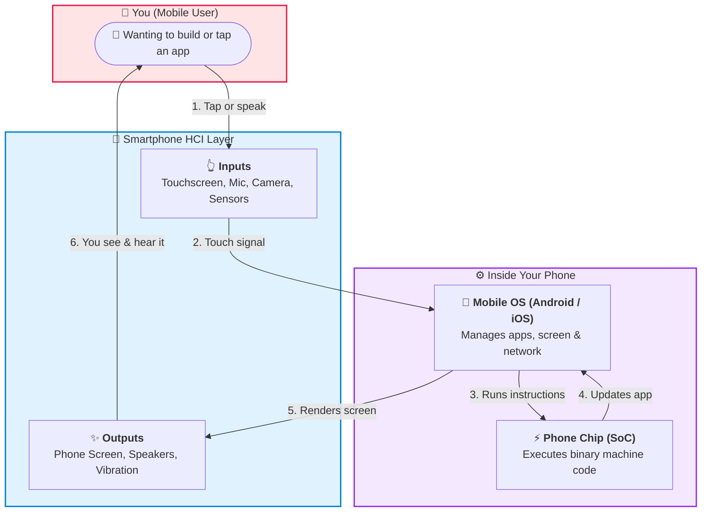
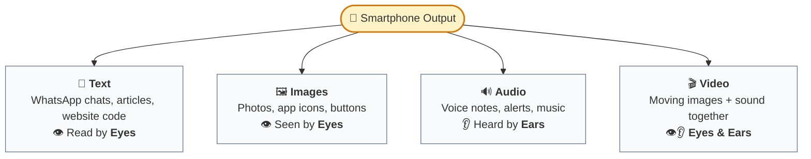
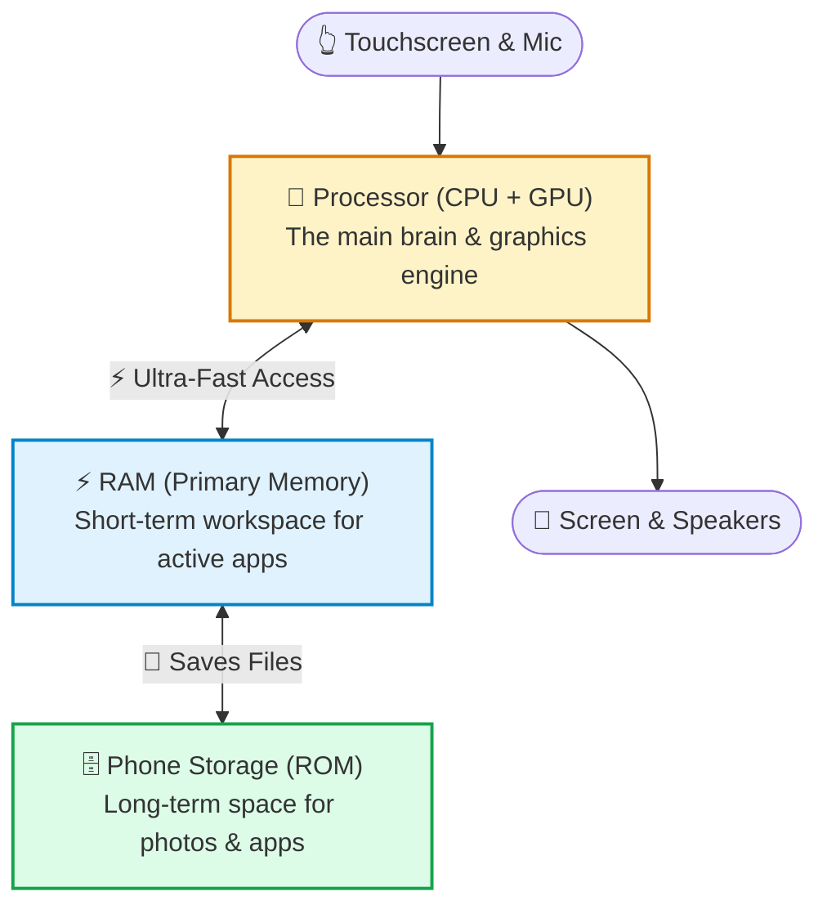
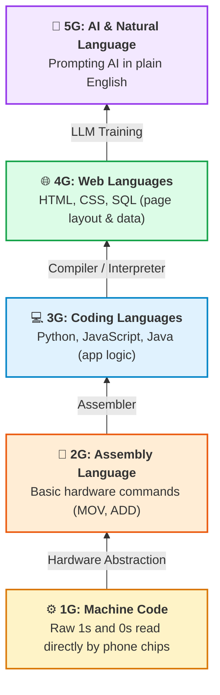
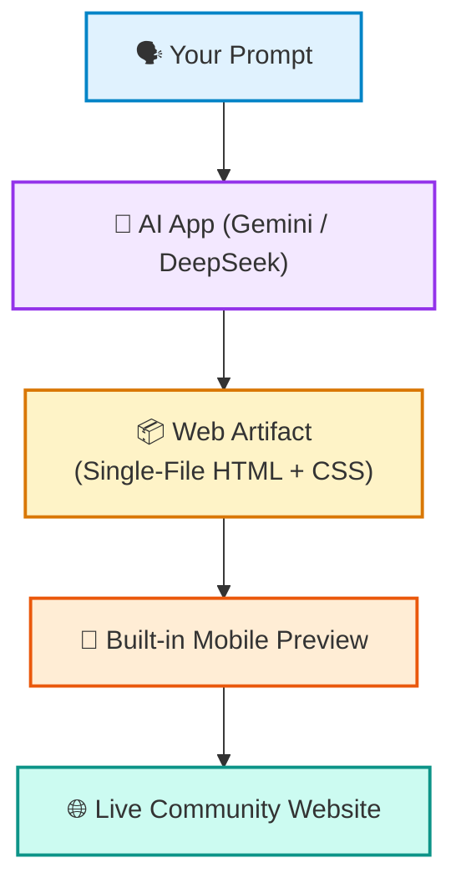
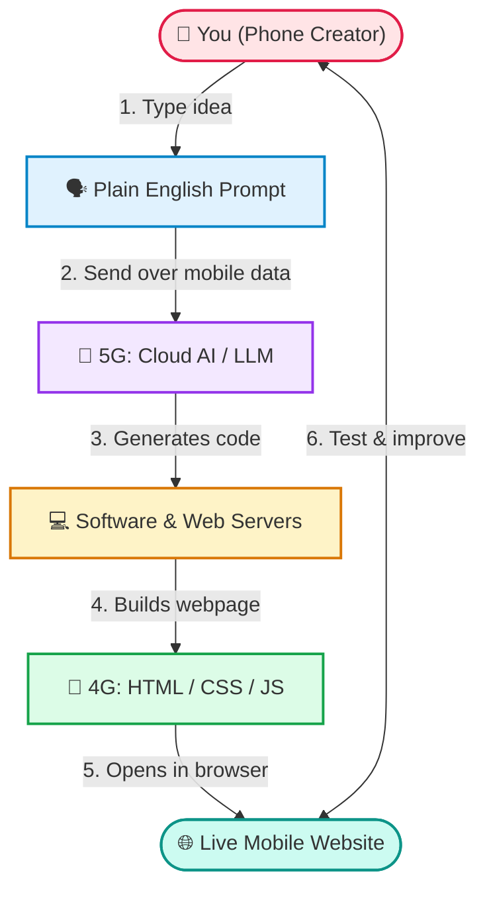
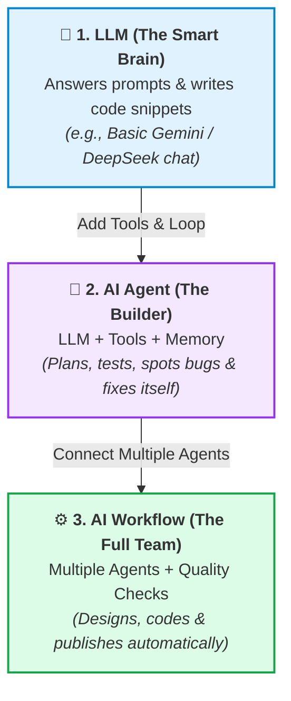

# 🚀 AI-Driven Web Development: Building Apps on Your Smartphone

A complete guide tracing how your smartphone works—from hardware and touchscreens up to building real community web apps with AI—no laptop or desktop required.

---

## 1. 📱 How Do You Control Your Phone?

> [!NOTE]
> **Answer:** Through a **Human-Computer Interface (HCI)**—the bridge that turns your finger taps and voice into binary signals (`1`s and `0`s) and sends visual or sound feedback back to you.



---

## 2. 📡 How Does Your Phone Show Information?

Your phone translates raw binary data (`1`s and `0`s) into **four sensory formats** made for human eyes and ears:



---

## 3. 🧩 What Is Inside a Physical Smartphone?

> [!NOTE]
> **Answer:** Even without a desktop tower, your phone uses the **Von Neumann Architecture**—four core hardware parts working together inside one small device.



* **🧠 CPU & GPU (The Brain):** The CPU runs app logic step-by-step; the GPU draws graphics and powers AI calculations.
* **⚡ RAM (Short-Term Memory):** Keeps your open apps running fast. *Analogy: Your school desk space while studying.*
* **🗄️ Phone Storage (Long-Term Memory):** Keeps your saved photos, apps, and web files even when the phone is off. *Analogy: Your school backpack.*
* **👆 Input / 📱 Output:** Your touchscreen, mic, speakers, and mobile data antenna.

---

## 4. 🪜 The 5 Generations of Computer Languages

> [!NOTE]
> **Answer:** Coding evolved from writing raw binary numbers (**1G**) to telling AI what to build in plain English on your phone (**5G**).



---

## 5. 📄 Artifacts & Mobile Coding Workarounds

When an AI bridges your English prompt (**5G**) with web code (**4G**), it creates an **Artifact**—a self-contained code block (like an HTML webpage) that you can preview and test separately from your chat.



> ⚠️ **Important Mobile Tip (Avoiding Cut-Off Code):**
> Copying long Markdown or code blocks inside mobile apps like **Gemini** or **DeepSeek** often cuts off the bottom half of the code! To avoid this on your phone:
> 1. **Use the Built-in Preview / Canvas button** inside the AI app to run the webpage directly on your screen without copying.
> 2. If you must copy code, tell the AI: *"Give me the code in 2 small parts so my phone doesn't cut it off."*
> 
> 

---

## 6. 🔄 What Is "AI-Driven Web Application Development"?

It is a step-by-step pipeline where your idea enters in plain English (**5G**), gets processed by AI models in the cloud, and comes back to your phone as working web code (**4G**).



---

## 7. 🧠 Core Building Blocks: LLM vs. Agent vs. Workflow

To turn your phone prompts into reliable websites, AI uses three levels of power:



* **🧠 LLM (Large Language Model):** Predicts text and writes code on demand, but cannot test if the code works on its own.
* **🦾 AI Agent:** Follows a loop (`Plan ➔ Act ➔ Observe ➔ Fix`). It checks its own errors and fixes broken code automatically.
* **⚙️ AI Workflow:** Connects several specialized agents together—one plans the layout, one writes the mobile HTML, and one publishes it online.

---

## 8. 🛠️ System Prompts, Approval Loops & Mobile Project

To save mobile data and stop the AI from making mistakes, smart phone developers use two rules:

1. **System Prompt:** Setting strict rules before starting (e.g., *"Keep it lightweight for slow mobile data"*).
2. **Clarification Loop:** Making the AI show you a short plan first so you can approve it before it generates heavy code.

### 8.1 Step 1: The System Prompt (Send This First)

```text
You are an expert web developer building fast, lightweight websites for smartphones in Kenya's informal settlements.
Rules:
1. Mobile-first design: big buttons, clear text, dark mode to save battery.
2. Keep the entire site in one compact HTML file to save mobile data.
3. Show me your plan and wait for my approval before writing code.

```

### 8.2 Step 2: The Clarification & Approval Chat

> **You:** *"Build a home page for Kenya Slums Digital Hub!"*
> **AI Agent:**
> *"Habari! Here is my plan for **Kenya Slums Digital Hub**:*
> 1. **Hero Banner:** Headline (*'Bridging the Digital Divide from the Ground Up'*) + button to join free coding classes.
> 2. **Community Stats:** 2,500+ youth trained, free daily Wi-Fi, and phone repair workshops.
> 3. **Mobile Design:** High-contrast dark theme with bright amber buttons, built in one lightweight HTML file.
> 
> 
> *Do you approve this plan?"*
> **You:** *"Approved! Build the single HTML file now."*

### 8.3 Step 3: The Mobile Web Artifact (Single-File HTML)

Instead of complex desktop setups (React/Node.js), the AI gives you **one clean HTML file** you can preview right on your phone:

```html
<!DOCTYPE html>
<html lang="en">
<head>
  <meta charset="UTF-8" />
  <meta name="viewport" content="width=device-width, initial-scale=1.0" />
  <title>Kenya Slums Digital Hub</title>
  <script src="https://cdn.tailwindcss.com"></script>
</head>
<body class="bg-slate-950 text-white font-sans p-5">

  <!-- Top Bar -->
  <header class="flex justify-between items-center pb-4 border-b border-slate-800">
    <div class="flex items-center gap-2">
      <span class="bg-amber-500 text-slate-950 font-black px-2 py-1 rounded">KSDH</span>
      <span class="font-bold text-sm">Kenya Slums Digital Hub</span>
    </div>
    <span class="bg-amber-500/20 text-amber-400 text-xs font-bold px-3 py-1 rounded-full">Active</span>
  </header>

  <!-- Main Content -->
  <main class="py-8 space-y-6">
    <span class="inline-block bg-amber-500/10 text-amber-400 border border-amber-500/20 text-xs font-semibold px-3 py-1 rounded-full">
      🇰🇪 Nairobi Informal Settlements
    </span>

    <h1 class="text-3xl font-extrabold leading-tight">
      Bridging the <span class="text-amber-500">Digital Divide</span> from the Ground Up
    </h1>

    <p class="text-slate-300 text-sm leading-relaxed">
      Free coding bootcamps, high-speed community Wi-Fi, and smartphone tech workshops built by youth, for youth.
    </p>

    <!-- Thumb-Friendly Mobile Buttons -->
    <div class="flex flex-col gap-3 pt-2">
      <button class="w-full bg-amber-500 text-slate-950 font-bold py-3.5 rounded-xl">
        Join Next Coding Class ➔
      </button>
      <button class="w-full bg-slate-900 border border-slate-700 text-slate-200 font-semibold py-3.5 rounded-xl">
        Check Free Wi-Fi Hours
      </button>
    </div>

    <!-- Community Impact Card -->
    <div class="bg-slate-900 border border-slate-800 rounded-2xl p-5 space-y-3 mt-6">
      <div class="text-xs font-bold text-amber-400 uppercase">Community Impact</div>
      <p class="text-sm text-slate-200">✅ 2,500+ Youth Trained in Digital Skills</p>
      <p class="text-sm text-slate-200">✅ Free Daily Study Hub Wi-Fi</p>
      <p class="text-sm text-slate-200">✅ Mobile-First Coding & Freelance Mentors</p>
    </div>
  </main>

</body>
</html>

```
