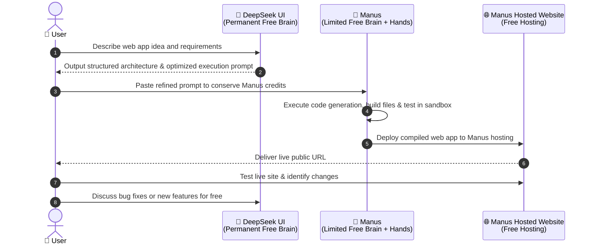
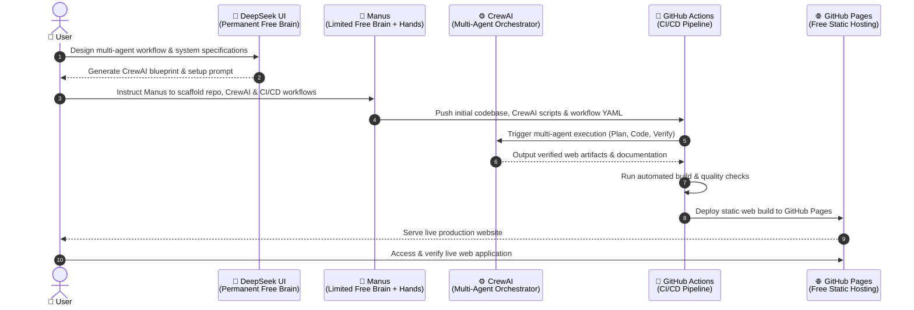

# E2E (End-To-End) Workflow
### 1. Direct Manus Workflow (Free Brain + Limited Brain with Hands + Manus Hosting)

In this pattern, **DeepSeek UI** handles heavy architectural planning and prompt refinement for free, preserving **Manus's** limited free credits strictly for execution, file creation, and instant hosting.

---

### 2. Orchestrated Pipeline (DeepSeek + Manus + CrewAI + GitHub Actions + GitHub Pages)

In this scalable CI/CD pattern, **Manus** acts as the hands-on builder to scaffold and configure a **CrewAI** multi-agent pipeline inside your repository, shifting ongoing generation and hosting onto **GitHub Actions** and **GitHub Pages** at zero cost.

---

### Architectural Comparison

| Aspect | Workflow 1: Direct Manus Hosting | Workflow 2: CrewAI + GitHub CI/CD |
| --- | --- | --- |
| **Role of DeepSeek UI** | Free architectural planner & prompt engineer | Free system designer & specification writer |
| **Role of Manus** | Full-stack coder & direct deployer | Repo scaffolder & environment bootstrapper |
| **Execution Engine** | Manus cloud sandbox (credit-bound) | GitHub Actions runners (automated/scheduled) |
| **Hosting Layer** | Manus built-in free hosting | GitHub Pages (version-controlled static hosting) |
| **Best For** | Rapid prototypes & single-session builds | Repeatable, automated, multi-agent production pipelines |